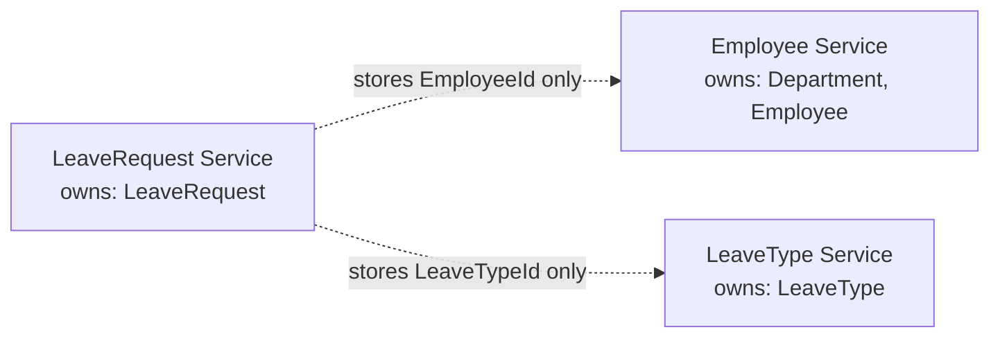
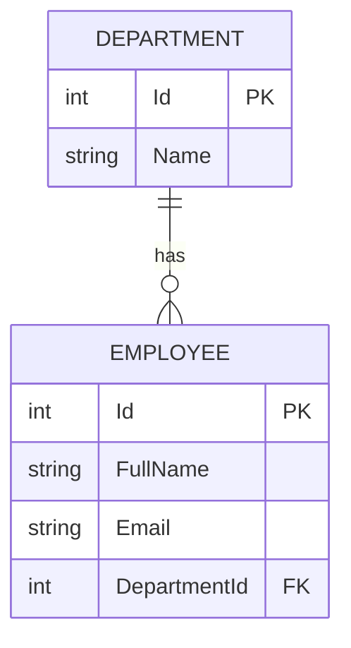
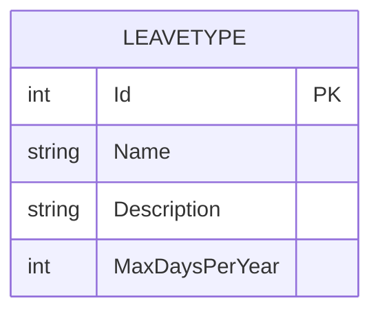
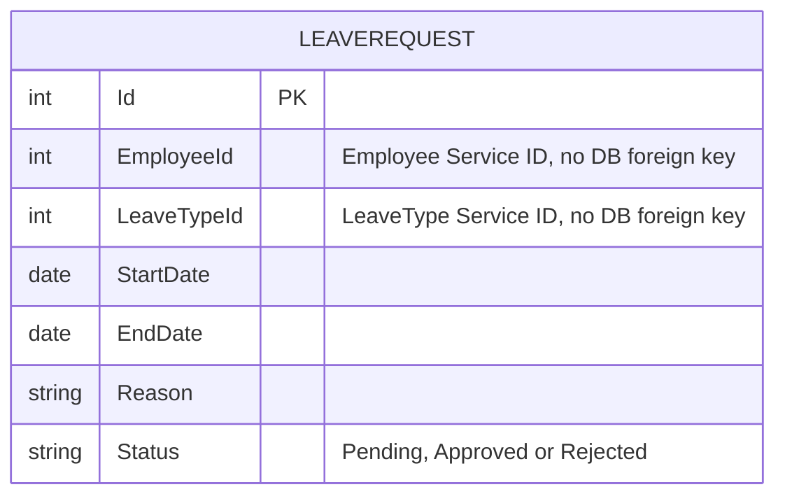

# Analyze Domains and Define Microservice Boundaries with ER Models

## What You Will Do

1. Decide which service **owns** which data.
2. Draw an **ER diagram** for each service.
3. Link the services using **IDs only**, with no database links between them.

---

## Step 1: Decide Which Service Owns What

A **domain** is a business area with its own rules. Each of our three domains gets one service, and each service owns the data of its domain:

| Service               | Owns                 | Why these belong together                                      |
| --------------------- | -------------------- | -------------------------------------------------------------- |
| `EmployeeService`     | Department, Employee | They change for the same reasons: hiring and transfers         |
| `LeaveTypeService`    | LeaveType            | Leave categories change on their own schedule (policy updates) |
| `LeaveRequestService` | LeaveRequest         | It changes most often and has its own approval workflow        |

**The rule:** Each service owns and manages its authoritative data. Other services should access that data through an agreed interface. Copies may be maintained when needed for caching or read performance, but they must be managed consistently.

---

## Step 2: Draw the ER Diagrams

Each service has its own diagram, and only entities inside that service appear in it.

### Employee Service

One department has many employees. `DepartmentId` is a real foreign key because both tables are in this service.

### LeaveType Service

`Name` holds values such as Casual, Sick, or Earned. `MaxDaysPerYear` is the yearly limit.

### LeaveRequest Service

`EmployeeId` and `LeaveTypeId` point to data owned by other services.

---

## Step 3: Link Services by ID, Not Foreign Keys

| Field                      | Lives in             | Points to                       | Database foreign key? |
| -------------------------- | -------------------- | ------------------------------- | --------------------- |
| `Employee.DepartmentId`    | Employee Service     | Department, same service        | **Yes**               |
| `LeaveRequest.EmployeeId`  | LeaveRequest Service | Employee, in Employee Service   | **No**                |
| `LeaveRequest.LeaveTypeId` | LeaveRequest Service | LeaveType, in LeaveType Service | **No**                |

**Why don't we use foreign keys between microservices?** A database foreign key normally enforces a relationship between tables within the same database.

In our example, Employee.DepartmentId is a foreign key because both tables belong to the Employee Service's data model.

However, LeaveRequest.EmployeeId refers to an employee managed by another service. We keep the ID without creating a database foreign key across the service boundary.

This allows each service to manage its own data independently. When we need employee details, the Leave Request Service can request them from the Employee Service through an API or another suitable communication mechanism.

---
