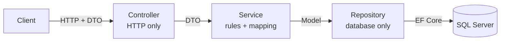

# Implement Layered Architecture Using Controllers, Services, Repositories & DTOs


## What You Will Do

Split `LeaveTypeService` into four small layers, where each class has exactly one job:

| Layer          | Job                                                | Real-world picture                  |
| -------------- | -------------------------------------------------- | ----------------------------------- |
| **Controller** | Receives HTTP requests, returns status codes       | The waiter                          |
| **Service**    | Holds the rules and converts between DTO and model | The chef                            |
| **Repository** | Reads and writes the database, nothing else        | The storeroom clerk                 |
| **DTO**        | The shape of data that crosses the API boundary    | The menu item shown to the customer |

---

## How a Request Travels



For `POST /api/leavetypes`:

1. The **controller** receives a `LeaveTypeDto`.
2. It hands the DTO to the **service**.
3. The service turns the DTO into a `LeaveType` model, ignoring any `Id` the client sent.
4. The service asks the **repository** to save it.
5. The repository saves it with EF Core and returns it.
6. The service turns the saved model back into a DTO, and the controller returns it with **201**.

## Files We Add or Change

```text
LeaveTypeService/
├── Controllers/
│   └── LeaveTypesController.cs     <- changed: thin, HTTP only
├── DTOs/
│   └── LeaveTypeDto.cs             <- new
├── Services/
│   ├── ILeaveTypesService.cs       <- new
│   └── LeaveTypesService.cs        <- new
├── Repositories/
│   ├── ILeaveTypesRepository.cs    <- new
│   └── LeaveTypesRepository.cs     <- new
├── Models/LeaveType.cs             <- unchanged
├── Data/AppDbContext.cs            <- unchanged
└── Program.cs                      <- changed: register the new classes
```

The model and context stay as they are, so **no new migration is needed**. This lab uses only packages from Lab 7.

---

## Step 1: Create the DTO

Create a folder `DTOs`, then add `DTOs/LeaveTypeDto.cs`:

```csharp
using System.ComponentModel.DataAnnotations;

namespace LeaveTypeService.DTOs;

public class LeaveTypeDto
{
    public int Id { get; set; }

    [Required]
    [MaxLength(100)]
    public string Name { get; set; } = string.Empty;

    public string Description { get; set; } = string.Empty;

    [Range(1, 365)]
    public int MaxDaysPerYear { get; set; }
}
```

---

## Step 2: Create the Repository

The repository does only database work. It has no rules, no HTTP, and no DTOs.

Create a folder `Repositories`, then add two files.

**`Repositories/ILeaveTypesRepository.cs`**

```csharp
using LeaveTypeService.Models;

namespace LeaveTypeService.Repositories;

public interface ILeaveTypesRepository
{
    Task<List<LeaveType>> GetAllAsync();
    Task<LeaveType?> GetByIdAsync(int id);
    Task<LeaveType> AddAsync(LeaveType leaveType);
    Task UpdateAsync(LeaveType leaveType);
    Task DeleteAsync(LeaveType leaveType);
}
```

**`Repositories/LeaveTypesRepository.cs`**

```csharp
using LeaveTypeService.Data;
using LeaveTypeService.Models;
using Microsoft.EntityFrameworkCore;

namespace LeaveTypeService.Repositories;

public class LeaveTypesRepository : ILeaveTypesRepository
{
    private readonly AppDbContext _db;

    public LeaveTypesRepository(AppDbContext db)
    {
        _db = db;
    }

    public async Task<List<LeaveType>> GetAllAsync()
    {
        return await _db.LeaveTypes.ToListAsync();
    }

    public async Task<LeaveType?> GetByIdAsync(int id)
    {
        return await _db.LeaveTypes.FindAsync(id);
    }

    public async Task<LeaveType> AddAsync(LeaveType leaveType)
    {
        _db.LeaveTypes.Add(leaveType);
        await _db.SaveChangesAsync();
        return leaveType;
    }

    public async Task UpdateAsync(LeaveType leaveType)
    {
        _db.LeaveTypes.Update(leaveType);
        await _db.SaveChangesAsync();
    }

    public async Task DeleteAsync(LeaveType leaveType)
    {
        _db.LeaveTypes.Remove(leaveType);
        await _db.SaveChangesAsync();
    }
}
```

---

## Step 3: Create the Service

The service applies the rules and converts between DTO and model. It knows nothing about HTTP, so it returns `null` or `false` for "not found" and lets the controller choose the status code.

Create a folder `Services`, then add two files.

**`Services/ILeaveTypesService.cs`**

```csharp
using LeaveTypeService.DTOs;

namespace LeaveTypeService.Services;

public interface ILeaveTypesService
{
    Task<List<LeaveTypeDto>> GetAllAsync();
    Task<LeaveTypeDto?> GetByIdAsync(int id);
    Task<LeaveTypeDto> CreateAsync(LeaveTypeDto dto);
    Task<bool> UpdateAsync(int id, LeaveTypeDto dto);
    Task<bool> DeleteAsync(int id);
}
```

**`Services/LeaveTypesService.cs`**

```csharp
using LeaveTypeService.DTOs;
using LeaveTypeService.Models;
using LeaveTypeService.Repositories;

namespace LeaveTypeService.Services;

public class LeaveTypesService : ILeaveTypesService
{
    private readonly ILeaveTypesRepository _repository;

    public LeaveTypesService(ILeaveTypesRepository repository)
    {
        _repository = repository;
    }

    public async Task<List<LeaveTypeDto>> GetAllAsync()
    {
        var items = await _repository.GetAllAsync();
        return items.Select(ToDto).ToList();
    }

    public async Task<LeaveTypeDto?> GetByIdAsync(int id)
    {
        var item = await _repository.GetByIdAsync(id);
        return item is null ? null : ToDto(item);
    }

    public async Task<LeaveTypeDto> CreateAsync(LeaveTypeDto dto)
    {
        var model = new LeaveType
        {
            Id = 0, // the database assigns the Id, so any value from the client is ignored
            Name = dto.Name,
            Description = dto.Description,
            MaxDaysPerYear = dto.MaxDaysPerYear
        };

        var saved = await _repository.AddAsync(model);
        return ToDto(saved);
    }

    public async Task<bool> UpdateAsync(int id, LeaveTypeDto dto)
    {
        var existing = await _repository.GetByIdAsync(id);
        if (existing is null)
        {
            return false;
        }

        existing.Name = dto.Name;
        existing.Description = dto.Description;
        existing.MaxDaysPerYear = dto.MaxDaysPerYear;

        await _repository.UpdateAsync(existing);
        return true;
    }

    public async Task<bool> DeleteAsync(int id)
    {
        var existing = await _repository.GetByIdAsync(id);
        if (existing is null)
        {
            return false;
        }

        await _repository.DeleteAsync(existing);
        return true;
    }

    // Model -> DTO: what the client is allowed to see
    private static LeaveTypeDto ToDto(LeaveType model)
    {
        return new LeaveTypeDto
        {
            Id = model.Id,
            Name = model.Name,
            Description = model.Description,
            MaxDaysPerYear = model.MaxDaysPerYear
        };
    }
}
```

---

## Step 4: Register the Layers

ASP.NET Core needs to know which class to use when something asks for an interface. This is **dependency injection**. Replace everything in `Program.cs`:

```csharp
using LeaveTypeService.Data;
using LeaveTypeService.Repositories;
using LeaveTypeService.Services;
using Microsoft.EntityFrameworkCore;
using Scalar.AspNetCore;

var builder = WebApplication.CreateBuilder(args);

builder.Services.AddControllers();

// Generates the OpenAPI document that Scalar reads
builder.Services.AddOpenApi();

builder.Services.AddDbContext<AppDbContext>(options =>
    options.UseSqlServer(builder.Configuration.GetConnectionString("DefaultConnection")));

// Layers: "when someone asks for the interface, give them this class"
builder.Services.AddScoped<ILeaveTypesRepository, LeaveTypesRepository>();
builder.Services.AddScoped<ILeaveTypesService, LeaveTypesService>();

var app = builder.Build();

// API documentation is for development only
if (app.Environment.IsDevelopment())
{
    app.MapOpenApi();
    app.MapScalarApiReference();
}

app.MapGet("/", () => "Leave Type Service is running");

app.MapGet("/health", () => Results.Ok(new
{
    service = "LeaveTypeService",
    status = "Running",
    responsibility = "Manages leave categories such as Casual, Sick and Earned leave"
}));

app.MapControllers();

app.Run();
```

- **Scoped** means one new object per HTTP request.

---

## Step 5: Rewrite the Controller

The controller now only handles HTTP. Replace everything in `Controllers/LeaveTypesController.cs`:

```csharp
using LeaveTypeService.DTOs;
using LeaveTypeService.Services;
using Microsoft.AspNetCore.Mvc;

namespace LeaveTypeService.Controllers;

[ApiController]
[Route("api/[controller]")]
public class LeaveTypesController : ControllerBase
{
    private readonly ILeaveTypesService _service;

    public LeaveTypesController(ILeaveTypesService service)
    {
        _service = service;
    }

    // GET /api/leavetypes
    [HttpGet]
    public async Task<ActionResult<List<LeaveTypeDto>>> GetAll()
    {
        return await _service.GetAllAsync();
    }

    // GET /api/leavetypes/1
    [HttpGet("{id}")]
    public async Task<ActionResult<LeaveTypeDto>> GetById(int id)
    {
        var item = await _service.GetByIdAsync(id);
        if (item is null)
        {
            return NotFound();
        }
        return item;
    }

    // POST /api/leavetypes
    [HttpPost]
    public async Task<ActionResult<LeaveTypeDto>> Create(LeaveTypeDto dto)
    {
        var created = await _service.CreateAsync(dto);
        return CreatedAtAction(nameof(GetById), new { id = created.Id }, created);
    }

    // PUT /api/leavetypes/1
    [HttpPut("{id}")]
    public async Task<IActionResult> Update(int id, LeaveTypeDto dto)
    {
        var found = await _service.UpdateAsync(id, dto);
        if (!found)
        {
            return NotFound();
        }
        return NoContent();
    }

    // DELETE /api/leavetypes/1
    [HttpDelete("{id}")]
    public async Task<IActionResult> Delete(int id)
    {
        var found = await _service.DeleteAsync(id);
        if (!found)
        {
            return NotFound();
        }
        return NoContent();
    }
}
```

---

## Step 6: Test All Endpoints (GetAll,Post,Update,Delete)

---
