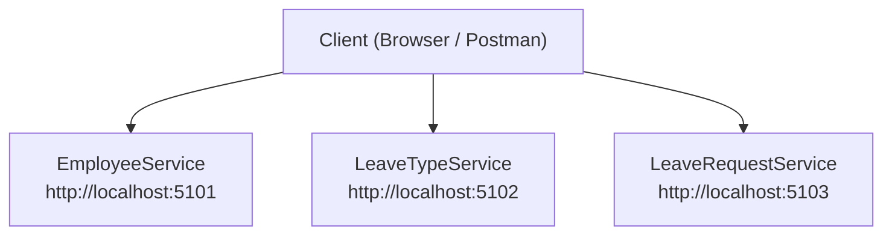

# Microservices Concepts & Baseline .NET API Architecture

---


## What We Will Build

Three small ASP.NET Core Web API projects. Each runs on its own port and has two endpoints: `/` and `/health`.

| Service               | Responsibility                                       | Port |
| --------------------- | ---------------------------------------------------- | ---- |
| `EmployeeService`     | Manages employee information                         | 5101 |
| `LeaveTypeService`    | Manages leave categories (Casual, Sick, Earned)      | 5102 |
| `LeaveRequestService` | Manages leave applications and their approval status | 5103 |

---

## Concept in Simple Words

**Monolith:** one big application does everything. If one part fails, the whole application can go down.

**Microservices:** many small applications, each owning one business job. They run separately and talk to each other over HTTP or messages.

---

## Practical Workflow



---

## Project Structure


---

## 7. Step-by-Step Implementation

### Step 1: Create the empty folders Leave-Management-System

### Step 2: Inside a Leave-Management-System Create SubFolder source (Leave-Management-System/source)

### Step 3: Create a new project → ASP.NET Core Web API

1. **Create a new project For Employee Services → ASP.NET Core Web API**.
   


2. Click **Create**.

### Step 4: Remove the template sample code

Delete these files:

- `WeatherForecast.cs`
- `Controllers/WeatherForecastController.cs`
- `EmployeeService.http`

### Step 4: Replace `Program.cs`

**File:** `source/EmployeeService/EmployeeService/Program.cs`

```csharp
var builder = WebApplication.CreateBuilder(args);

// Controllers are enabled now, used from Lab 7 onward
builder.Services.AddControllers();

var app = builder.Build();

// Proves the service is alive
app.MapGet("/", () => "Employee Service is running");

// JSON response: shows what a real API reply looks like
app.MapGet("/health", () => Results.Ok(new
{
    service = "EmployeeService",
    status = "Running",
    responsibility = "Manages employee information"
}));

app.MapControllers();

app.Run();
```

### Step 5: Set a fixed port

**File:** `Properties/launchSettings.json`

In the profile named `"http"` & `"https"`, change `applicationUrl`:

```json
"launchBrowser": true,
"applicationUrl": "http://localhost:5101"

```

### Step 6: Run and verify EmployeeService


### Step 7: Create LeaveTypeService and LeaveRequestService


**`LeaveTypeService/Program.cs`** (port **5102**)

```csharp
var builder = WebApplication.CreateBuilder(args);

builder.Services.AddControllers();

var app = builder.Build();

app.MapGet("/", () => "Leave Type Service is running");

app.MapGet("/health", () => Results.Ok(new
{
    service = "LeaveTypeService",
    status = "Running",
    responsibility = "Manages leave categories such as Casual, Sick and Earned leave"
}));

app.MapControllers();

app.Run();
```

```json
"launchBrowser": true,
"applicationUrl": "http://localhost:5102"

```

**`LeaveRequestService/Program.cs`** (port **5103**)

```csharp
var builder = WebApplication.CreateBuilder(args);

builder.Services.AddControllers();

var app = builder.Build();

app.MapGet("/", () => "Leave Request Service is running");

app.MapGet("/health", () => Results.Ok(new
{
    service = "LeaveRequestService",
    status = "Running",
    responsibility = "Manages leave applications and their approval status"
}));

app.MapControllers();

app.Run();
```

```json
"launchBrowser": true,
"applicationUrl": "http://localhost:5103"

```

## Step 8 : Run and verify LeaveTypeService/LeaveRequestService

## -1.png>)

## 9. Run the All Services into Together


## 
