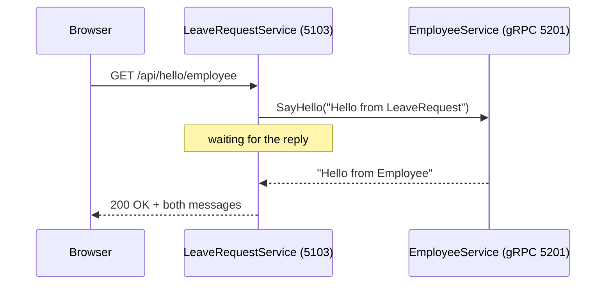

# Synchronous Communication with gRPC


## What Will Do

Make LeaveRequestService send the message **"Hello from LeaveRequest"** to EmployeeService, and wait until EmployeeService replies **"Hello from Employee"**.

**What gRPC is, in simple words:**

1. A small file, the **`.proto`**, lists what can be called and what the messages look like. It is the contract.
2. Both services keep their **own copy** of that file and generate C# code from it.
3. LeaveRequestService then calls a method on EmployeeService almost as if the method were local.

---

## How the Call Travels



# EmployeeService

## Install the Package

```bash
dotnet add package Grpc.AspNetCore
```

## Write the Contract

Create a folder `Protos`, then add `Protos/hello.proto`:

```proto
syntax = "proto3";

option csharp_namespace = "EmployeeService.Protos";

package hello;

service Greeter {
  rpc SayHello (HelloRequest) returns (HelloReply);
}

message HelloRequest {
  string message = 1;
}

message HelloReply {
  string message = 1;
}
```

- `service Greeter` is a group of methods that can be called, and `rpc SayHello (...) returns (...)` is one of them.
- A `message` is a data shape, like a C# class.
- The numbers (`= 1`) are **field numbers**. They identify each field in the binary data, so never change them once used.
- `csharp_namespace` sets the C# namespace of the generated code.

## Add Protobuf in EmployeeService.csproj

Open `EmployeeService.csproj` (right-click the project → **Edit Project File**) and add this inside `<Project>`:

```xml
<ItemGroup>
  <Protobuf Include="Protos\hello.proto" GrpcServices="Server" />
</ItemGroup>
```

`GrpcServices="Server"` generates the **server** base class for this service to inherit.

## Write the Reply Class

Create a folder `GrpcServices`, then add `GrpcServices/HelloGrpcService.cs`:

```csharp
using EmployeeService.Protos;
using Grpc.Core;

namespace EmployeeService.GrpcServices;

public class HelloGrpcService : Greeter.GreeterBase
{
    public override Task<HelloReply> SayHello(HelloRequest request, ServerCallContext context)
    {
        // Prints in the EmployeeService console, so you can see the call arrive
        Console.WriteLine($"EmployeeService received: {request.Message}");

        return Task.FromResult(new HelloReply { Message = "Hello from Employee" });
    }
}
```

`Greeter.GreeterBase` is generated from the `.proto` file. We inherit it and fill in the reply.

## Open the gRPC Port

In `appsettings.json`, add this block at the top level (next to the other sections):

```json
"Kestrel": {
  "Endpoints": {
    "Rest": { "Url": "http://localhost:5101", "Protocols": "Http1" },
    "Grpc": { "Url": "http://localhost:5201", "Protocols": "Http2" }
  }
},
```

- `Rest` is the same port 5101 as before, on HTTP/1.1.
- `Grpc` is the new port 5201, on HTTP/2 only.

## Register gRPC

In `Program.cs`, make **three small additions** and leave the rest of the file as it is.

At the top:

```csharp
using EmployeeService.GrpcServices;
```

After `builder.Services.AddControllers();`:

```csharp
builder.Services.AddGrpc();
```

After `app.MapControllers();`:

```csharp
app.MapGrpcService<HelloGrpcService>();
```

## Build and Run

# LeaveRequestService

## Install the Packages

```bash
dotnet add package Grpc.Net.ClientFactory
dotnet add package Google.Protobuf
dotnet add package Grpc.Tools
```

| Package                  | What it does                                                     |
| ------------------------ | ---------------------------------------------------------------- |
| `Grpc.Net.ClientFactory` | Creates and manages gRPC clients, using the dependency injection |
| `Google.Protobuf`        | Reads and writes the message format                              |
| `Grpc.Tools`             | Generates C# code from the `.proto` file at build time           |

## Copy the Contract

Create a folder `Protos`, then add `Protos/hello.proto`:

```proto
syntax = "proto3";

option csharp_namespace = "LeaveRequestService.Protos";

package hello;

service Greeter {
  rpc SayHello (HelloRequest) returns (HelloReply);
}

message HelloRequest {
  string message = 1;
}

message HelloReply {
  string message = 1;
}
```

## Add Protobuf in LeaveRequestService.csproj

Open `LeaveRequestService.csproj` and add this inside `<Project>`:

```xml
<ItemGroup>
  <Protobuf Include="Protos\hello.proto" GrpcServices="Client" />
</ItemGroup>
```

`GrpcServices="Client"` generates the **client** class, where EmployeeService generated the base class.

## Register the Client

At the top:

```csharp
using LeaveRequestService.Protos;
```

Before `var app = builder.Build();`:

```csharp
// gRPC client: point it at EmployeeService's gRPC port (5201, not 5101)
builder.Services.AddGrpcClient<Greeter.GreeterClient>(options =>
{
    options.Address = new Uri("http://localhost:5201");
});
```

This is the **gRPC port, 5201**.

## Add a Endpoint

Add `Controllers/HelloController.cs`:

```csharp
using Grpc.Core;
using LeaveRequestService.Protos;
using Microsoft.AspNetCore.Mvc;

namespace LeaveRequestService.Controllers;

[ApiController]
[Route("api/[controller]")]
public class HelloController : ControllerBase
{
    private readonly Greeter.GreeterClient _greeter;

    public HelloController(Greeter.GreeterClient greeter)
    {
        _greeter = greeter;
    }

    // GET /api/hello/employee
    [HttpGet("employee")]
    public async Task<IActionResult> SayHelloToEmployee()
    {
        try
        {
            // Synchronous call: we wait here until EmployeeService replies
            var reply = await _greeter.SayHelloAsync(
                new HelloRequest { Message = "Hello from LeaveRequest" });

            return Ok(new
            {
                sent = "Hello from LeaveRequest",
                received = reply.Message
            });
        }
        catch (RpcException)
        {
            return StatusCode(503, "Employee service is not reachable.");
        }
    }
}
```

- `Greeter.GreeterClient` is generated from the `.proto` file. Calling `_greeter.SayHelloAsync(...)` looks like a local method call, but it travels to another service.
- `RpcException` is what gRPC throws when a call fails, for example when EmployeeService is stopped. We turn it into a clear **503 Service Unavailable**.

## Build and Run & Test a Endpoint `GET /api/Hello/employee`


